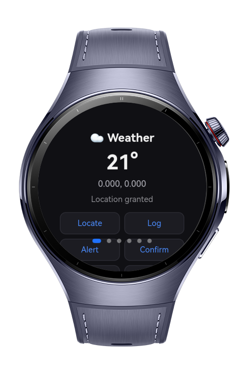
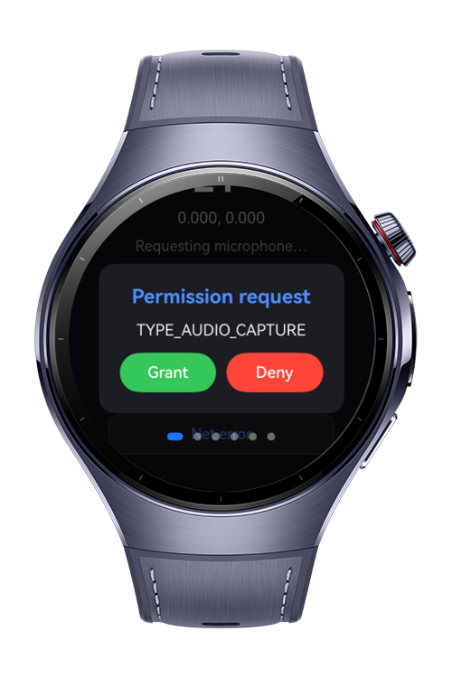
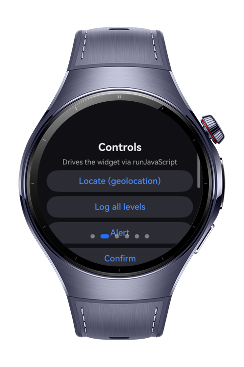
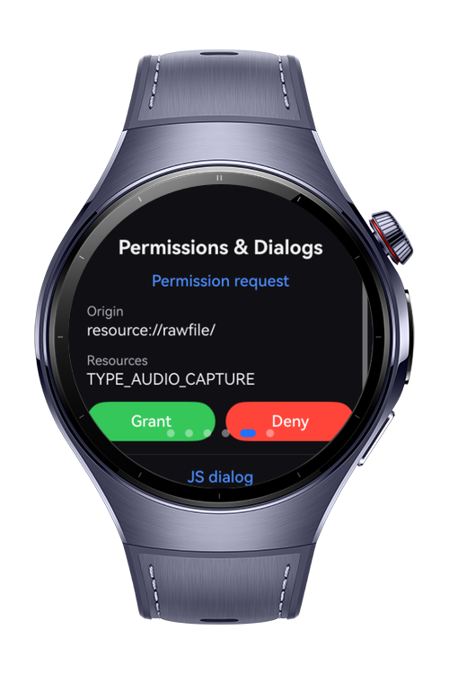

> **Note:** To access all shared projects, get information about environment setup, and view other guides, please visit [Explore-In-HMOS Index](https://github.com/Explore-In-HMOS/hmos-index).

# How to Build Web Permission Console

A wearable web-content permission and debugging framework for HarmonyOS Next smart wearables. The app hosts a local weather widget inside an ArkWeb `Web` component and demonstrates how to grant per-origin location permission, answer web permission requests, intercept `console.*` output for debugging, resolve JavaScript dialogs, and classify network errors. The codelab teaches how to safely host interactive web content on a watch and react to everything the page asks for.

# Preview

<div>
  
  
  
  
</div>

# Use Cases

- **Web Permission Hosting**: Demonstrates how to answer a page's geolocation request with `JsGeolocation` and manage the per-origin permission store with `GeolocationPermissions`, plus grant/deny media requests via `PermissionRequest`.
- **In-App Web Debugging**: Shows how to intercept `console.log/info/warn/error/debug` output from web content with `ConsoleMessage` and surface it in a native console panel.
- **Interactive Content & Error Handling**: Illustrates resolving JavaScript `alert/confirm/prompt` dialogs with `JsResult` and classifying `onErrorReceive` failures with the `WebNetErrorList` / `netErrorList` codes.

**Target APIs**

| Module | Method | Role |
|---|---|---|
| GeolocationPermissions | `allowGeolocation` / `deleteGeolocation` / `deleteAllGeolocation` / `getAccessibleGeolocation` / `getStoredGeolocation` | Manage the per-origin geolocation permission store |
| JsGeolocation | `invoke` | Answer a page's `onGeolocationShow` request (allow/deny/retain) |
| PermissionRequest | `getAccessibleResource` / `grant` / `deny` | Handle web permission (microphone) requests |
| ConsoleMessage | `getMessage` / `getMessageLevel` / `getSourceId` / `getLineNumber` | Intercept `console.*` output for debugging |
| JsResult | `handleConfirm` / `handleCancel` / `handlePromptConfirm` | Resolve JavaScript alert/confirm/prompt dialogs |
| WebResourceError | `getErrorCode` / `getErrorInfo` | Report a failed request in `onErrorReceive` |
| WebNetErrorList / netErrorList | error code enum | Classify network error codes into human-readable categories |

# Technology

## Stack
- **Languages**: ArkTS, ArkUI
- **Frameworks**: HarmonyOS SDK 6.0.1(21)
- **Tools**: DevEco Studio Version 6.0.1.251
- **Libraries & Kits**:
    - `@kit.ArkWeb` — `Web` component, `webview.WebviewController`, `GeolocationPermissions`
    - `@ohos.web.netErrorList` — `WebNetErrorList` network error code enumeration
    - `@kit.AbilityKit` — `abilityAccessCtrl` for runtime permission requests
    - `@kit.BasicServicesKit` — `BusinessError` handling
    - `@kit.PerformanceAnalysisKit` — hilog for logging

## Required Permissions
- ohos.permission.INTERNET
- ohos.permission.APPROXIMATELY_LOCATION
- ohos.permission.LOCATION
- ohos.permission.MICROPHONE

# Directory Structure
```
entry/src/main/ets/
├── entryability/
│   └── EntryAbility.ets            // Main entry point, loads WebHost and requests runtime permissions
├── pages/
│   ├── WebHost.ets                 // Host page: owns WebviewController, wires all Web callbacks and overlays
├── components/
│   ├── ConsolePanel.ets            // Console message stream (ConsoleMessage)
│   ├── GeolocationPanel.ets        // Geolocation request + permission store (GeolocationPermissions / JsGeolocation)
│   ├── PermissionDialogPanel.ets   // Permission request & JS dialog history (PermissionRequest / JsResult)
│   └── NetErrorBanner.ets          // Classified network error (WebNetErrorList / netErrorList)
└── model/
    ├── WebHostState.ets            // Observable state shared across panels
    ├── WebConsoleStore.ets         // Captured console log buffer
    ├── NetErrorClassifier.ets      // Maps WebNetErrorList codes to categories
    └── PermissionsHelper.ets       // Runtime permission requests

entry/src/main/resources/rawfile/demo/
├── index.html                      // Weather widget that triggers each Web capability
└── demo.js                         // Triggers geolocation, console, dialogs, getUserMedia and a net error
```
# Constraints and Restrictions

## Supported Device
- Huawei Watch 5

## Requirements
- HarmonyOS API level 20 or higher
- Network connectivity is optional — the network-error demo still yields a deterministic error code offline
- The ArkWeb `Web` component is generally unavailable on the `wearable` device type at runtime; the app guards it with `canIUse` and shows a fallback screen. Run the sample on a phone/tablet target to exercise the live Web callbacks.

# License
How to Build Web Content Permission & Console for HarmonyOS is distributed under the terms of the [LICENSE](./LICENSE).
